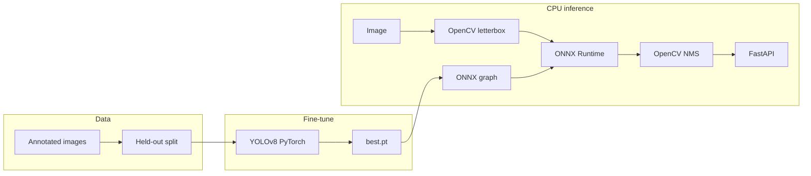

# VisionGuard

VisionGuard fine-tunes a YOLOv8 detector for visual defect inspection, measures it with mAP, precision/recall and a confusion matrix, exports the PyTorch weights to ONNX, and serves CPU inference from a FastAPI app. OpenCV handles letterboxing and non-maximum suppression on either side of the ONNX Runtime session.

The repository can draw its own annotated plates (scratches, cracks, and spots) so the whole path runs on a laptop. The trainer only reads a YOLO dataset. Point `data.yaml` at a real inspection set and the same commands apply.

## Features

- Stratified train/val split, taken before any augmentation, so a validation image cannot end up inside a training mosaic.
- YOLOv8 fine-tune in PyTorch, starting from pretrained `yolov8n.pt`, with mosaic, horizontal flip, and HSV colour jitter.
- Validation during training (Ultralytics plots) and a second pass on the exported graph: mAP@0.5, mAP@0.5:0.95, precision, recall, and a confusion matrix that includes background.
- ONNX export with raw boxes and class scores. NMS stays in OpenCV (`cv2.dnn.NMSBoxes`), so the confidence threshold can change without another export.
- Dockerized FastAPI service. `POST /detect` returns boxes and scores. Pytest covers the geometry, the metrics, and the HTTP API.

## Architecture



An image arrives as bytes. OpenCV decodes it, letterboxes it to the network's square input, converts BGR to RGB, and scales pixels to 0–1. ONNX Runtime runs the exported YOLOv8 graph on CPU. Each anchor comes back as a centre, a width, a height, and one score per class. OpenCV drops weak and overlapping rows, then the letterbox padding is removed so the surviving boxes are in the original image. FastAPI returns that list as JSON.

## Folder structure

```
visionguard/
  __main__.py          synthesize, split, preview, train, export, evaluate, serve
  train.py             YOLOv8 fine-tune
  export.py            checkpoint to ONNX
  classes.py           scratch, crack, spot
  settings.py          environment variables and .env
  data/
    synthesize.py      synthetic plates and YOLO labels
    splits.py          held-out train/val split
    augment.py         mosaic, flip, colour jitter, trainer hyperparameters
    preview.py         writes a few augmented samples
    yolo.py            label files
  eval/
    metrics.py         mAP, precision/recall, confusion matrix
    report.py          confusion-matrix image
    run.py             score a split with the ONNX detector
  infer/
    preprocess.py      OpenCV letterbox
    postprocess.py     decode boxes and NMS
    detector.py        ONNX Runtime session
  api/
    app.py             FastAPI
    schemas.py
tests/
Dockerfile
docker-compose.yml
```

Training checkpoints land in `runs/detect/visionguard/`. The ONNX file the service loads is `models/visionguard.onnx`. Both directories are gitignored apart from a placeholder.

## Run locally

Python 3.10 or newer.

```bash
python -m venv .venv
source .venv/bin/activate
pip install -e ".[dev]"
```

Draw a dataset, look at the augmentations, then fine-tune. Training needs PyTorch and Ultralytics. The CPU wheel index keeps that install small; a CUDA machine can install its own PyTorch and then `pip install ultralytics`.

```bash
pip install -r requirements-train.txt
python -m visionguard synthesize --count 80 --size 640 --out data/defects
python -m visionguard preview-aug --data data/defects --out runs/preview
python -m visionguard train --data data/defects/data.yaml --epochs 50 --imgsz 640 --batch 8 --device cpu
python -m visionguard export --weights runs/detect/visionguard/weights/best.pt --out models/visionguard.onnx
python -m visionguard evaluate --model models/visionguard.onnx --data data/defects/data.yaml
```

`evaluate` writes `runs/eval/metrics.json`, `metrics.txt`, and `confusion_matrix.png`.

A shorter smoke run is the same commands with `--count 40 --size 320` on synthesize and `--epochs 5 --imgsz 320 --batch 4` on train.

Serve the exported graph:

```bash
cp .env.example .env
uvicorn visionguard.api.app:app --host 0.0.0.0 --port 8000
curl -F "file=@data/defects/images/val/<image>.png" http://localhost:8000/detect
```

`GET /health` reports whether a model file was found. `GET /labels` lists the class names. With no file at `MODEL_PATH`, the process still starts and `/detect` answers 503.

### Bring your own images

Lay the pool out as `images/` and `labels/` (YOLO `class cx cy w h`, one file per image, empty file if the plate is clean). Then:

```bash
python -m visionguard split --source /path/to/pool --out data/defects --val-ratio 0.2 --seed 7
```

Class names default to `scratch,crack,spot`. Change `names` in the generated `data.yaml`, pass the same list as `CLASS_NAMES` when you serve, and keep the export image size equal to the training `imgsz`.

### Docker

The image is the inference service only. It does not contain PyTorch.

```bash
docker build -t visionguard:latest .
docker compose up
```

Compose mounts `./models` at `/models` and sets `MODEL_PATH=/models/visionguard.onnx`.

### Configuration

| Variable | Default | Role |
| --- | --- | --- |
| `MODEL_PATH` | `models/visionguard.onnx` | ONNX file. Missing file means the API stays up and `/detect` returns 503. |
| `CONF_THRESHOLD` | `0.25` | Score cutoff before NMS. |
| `IOU_THRESHOLD` | `0.45` | NMS overlap cutoff. |
| `CLASS_NAMES` | `scratch,crack,spot` | Comma-separated labels, in the order the graph was trained. |
| `IMG_SIZE` | taken from the ONNX input | Used only when the exported input is dynamic. A fixed square input keeps its own size. |

Copy `.env.example` to `.env`. Values already set in the environment are left alone.

## Tests

```bash
pytest
ruff check visionguard tests
docker build -t visionguard:latest .
```

`make test`, `make lint`, and `make docker` wrap the same commands. The unit tests build a small ONNX graph with a known box so detection, metrics, and the HTTP API run without a training checkpoint. `train` and `export` are exercised against a stand-in for the Ultralytics entry points, and they call the real library when it is installed.

## Design decisions

The validation split is chosen from the raw files, stratified by the majority defect on each image. Augmentation runs only on the training batches after that. A class with a single picture stays in train, so the hold-out does not become the only example of that defect.

Mosaic, horizontal flip, and HSV colour jitter are the batch augmentations passed to the YOLOv8 trainer (`mosaic`, `fliplr`, `hsv_h`, `hsv_s`, `hsv_v`). Vertical flip, rotation, translation, scale, channel swap, mixup, and random erasing stay at zero, because the parts sit in a fixture. On a run longer than 20 epochs, mosaic turns off for the last 10 epochs so the final weights see objects at their normal scale. Shorter runs keep mosaic on throughout, otherwise it would never run. The same three operations are implemented in `visionguard/data/augment.py` for the preview command and the tests. The trainer's own mosaic uses a random centre rather than a fixed 2×2 grid; the preview uses the grid so the box math is easy to check by eye.

The served model is ONNX Runtime on CPU, with `CPUExecutionProvider` only. The Docker image therefore does not carry a training stack, and a laptop and the container see the same execution provider. Letterbox padding uses the YOLOv8 fill value 114 and always produces the square the exported graph expects. Boxes are decoded here, then suppressed per class with OpenCV NMS. Two different defect classes may occupy one region and both be returned.

Training already asks Ultralytics to validate and to write its own plots, including a confusion matrix. `visionguard evaluate` runs the ONNX graph over the same split and computes mAP, precision, recall, and a confusion matrix again. That second pass is what shows a drift in letterbox or in the score layout. mAP@0.5:0.95 is the mean of average precision at IoU thresholds 0.50, 0.55, …, 0.95. Average precision uses all-point interpolation. For precision and recall, a prediction matches a ground-truth box of the same class in the same image. The confusion matrix may match across classes, so a scratch called a crack is an off-diagonal cell. The background row and column hold false positives and false negatives.

Synthetic plates are a stand-in for a line dataset: grey stock, a thin border, and painted defects with boxes taken from the pixels that were drawn. Nothing in the trainer special-cases them.
